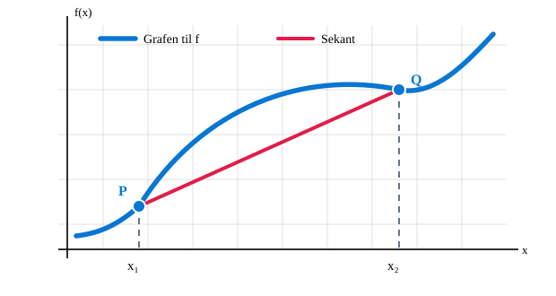

# 3.1 Vekstfart og tangent

## Læringsmål

Når du har arbeidet med dette delkapitlet, skal du kunne:

- skille mellom **gjennomsnittlig** og **momentan vekstfart**
- beregne gjennomsnittlig vekstfart mellom to x-verdier
- forklare at momentan vekstfart er stigningstallet til tangenten i punktet
- finne tangentens funksjonsuttrykk ved å bruke formen \(y=ax+b\)

!!! important "Kort repetisjon – dette må du kunne"
    - **Gjennomsnittlig vekstfart:** stigningstallet til sekanten mellom to punkter.
    - **Momentan vekstfart:** stigningstallet til tangenten i ett punkt.
    - **Tangentlikning:** bruk punktet \(P=(x_1,y_1)\) og den deriverte i punktet: \(y-y_1=f'(x_1)(x-x_1)\).

    Hvis du kan forklare disse tre punktene og bruke formlene, gå direkte til oppgavene for å kontrollere at du husker metoden.

## Hvorfor bryr vi oss om den deriverte?

Den deriverte hjelper oss å beskrive **hvor raskt noe endrer seg akkurat nå**. Det er nyttig i mange situasjoner:

- **Fart:** Hvor fort kjører bilen akkurat i dette øyeblikket?
- **Grafer:** Hvor raskt øker eller minker en funksjon på et bestemt sted?

I alle disse eksemplene handler det om endring. Den deriverte gir oss et mål på hvor rask endringen er. I dette kapittelet skal vi se at den også kan forstås geometrisk: Den deriverte i et punkt er stigningstallet til tangenten til grafen i punktet.

## 1. Gjennomsnittlig og momentan vekstfart

Tenk at du sykler en tur. Gjennomsnittsfarten beskriver hele turen, mens sykkelcomputeren kan vise farten **akkurat nå**. Dette er to forskjellige spørsmål.

| Gjennomsnittlig vekstfart | Momentan vekstfart |
|---|---|
| Endring **mellom to punkter** på grafen. | Endring **i ett bestemt punkt** på grafen. |
| Vi bruker en **sekant** gjennom to punkter. | Vi bruker en **tangent** i ett punkt. |
| Som gjennomsnittsfarten på en hel tur. | Som farten sykkelcomputeren viser akkurat nå. |

Begge beskriver hvor raskt noe endrer seg. Forskjellen er om vi ser på et helt intervall eller ett bestemt øyeblikk.

## 2. Hva betyr den deriverte i et punkt?

Den deriverte til en funksjon \(f\) i punktet \(x=a\) skrives

\[
f'(a)
\]

Verdien \(f'(a)\) forteller hvor raskt funksjonen endrer seg akkurat når \(x=a\). Det er den **momentane vekstfarten**.

Geometrisk forteller den samme verdien oss **stigningstallet til tangenten** til grafen i punktet \(P=(x_1,y_1)\).

### Figur 1 – Graf, punkt og tangent

Se på funksjonen \(f(x)=x^2\) og punktet \(P=(1,1)\).

<figure markdown>
<svg viewBox="0 0 360 270" role="img" aria-label="Grafen y lik x i andre og tangenten y lik 2x minus 1 i punktet 1,1" xmlns="http://www.w3.org/2000/svg">
  <defs>
    <clipPath id="plot1"><rect x="42" y="18" width="286" height="218"/></clipPath>
  </defs>
  <g stroke="currentColor" stroke-opacity="0.13" stroke-width="1">
    <path d="M60 20V236 M100 20V236 M140 20V236 M180 20V236 M220 20V236 M260 20V236 M300 20V236"/>
    <path d="M42 36H328 M42 76H328 M42 116H328 M42 156H328 M42 196H328 M42 236H328"/>
  </g>
  <g stroke="currentColor" stroke-width="1.4" fill="none">
    <path d="M42 196H333"/>
    <path d="M60 242V14"/>
  </g>
  <g fill="currentColor" font-size="10">
    <text x="334" y="191">x</text><text x="67" y="15">y</text>
    <text x="48" y="209">0</text><text x="96" y="209">1</text><text x="136" y="209">2</text><text x="176" y="209">3</text>
    <text x="44" y="160">1</text><text x="44" y="120">2</text><text x="44" y="80">3</text><text x="44" y="40">4</text>
  </g>
  <g clip-path="url(#plot1)">
    <path d="M60 196 C73.3 196 86.7 182.7 100 156 C113.3 129.3 126.7 89.3 140 36" fill="none" stroke="#16803d" stroke-width="3"/>
    <path d="M60 236 L140 76" fill="none" stroke="#d97706" stroke-width="2.5"/>
    <path d="M100 156 L140 156 L140 76" fill="none" stroke="#d97706" stroke-width="1.5" stroke-dasharray="4 3"/>
  </g>
  <circle cx="100" cy="156" r="5" fill="#16803d" stroke="white" stroke-width="1.3"/>
  <g fill="currentColor" font-size="10">
    <text x="105" y="148">P = (1, 1)</text>
    <text x="104" y="171" fill="#d97706">1 rute bort</text>
    <text x="145" y="119" fill="#d97706">2 ruter opp</text>
    <text x="203" y="52" fill="#16803d">f(x) = x²</text>
  </g>
</svg>
<figcaption>Fra P går vi 1 rute mot høyre og 2 ruter opp langs tangenten. Stigningstallet er derfor 2/1 = 2. Tangenten berører grafen i P.</figcaption>
</figure>

For denne funksjonen er den deriverte i \(x=1\) lik \(f'(1)=2\). Det betyr at tangenten i punktet \(P=(x_1,y_1)=(1,1)\) har stigningstall 2.

**Husk:** \(f'(1)\) er et tall – stigningstallet akkurat i punktet \(x=1\). \(f'(x)\) betegner derimot den deriverte som en funksjon av \(x\).

## 3. Gjennomsnittlig vekstfart

Den **gjennomsnittlige vekstfarten** forteller hvor mye funksjonsverdien endrer seg i gjennomsnitt når vi går fra én x-verdi til en annen. Geometrisk er den stigningstallet til en **sekant** – en rett linje som går gjennom to punkter på grafen.

!!! important "Formel for gjennomsnittlig vekstfart"
    \[
    a=\dfrac{f(x_2)-f(x_1)}{x_2-x_1}
    \]

Her er \(x_1\) og \(x_2\) start- og sluttverdiene på x-aksen. Telleren viser endringen i funksjonsverdi, og nevneren viser endringen i x.

### Sekant: gjennomsnittlig vekstfart

Den blå kurven viser grafen til \(f\), mens den røde, rette linjen er sekanten gjennom P og Q. **Sekantens stigningstall** er den gjennomsnittlige vekstfarten mellom \(x_1\) og \(x_2\).

!!! example "Eksempel – Finn gjennomsnittlig vekstfart"

    La \(f(x)=x^2\). Vi finner gjennomsnittlig vekstfart fra \(x=1\) til \(x=4\).

    **Steg 1: Finn funksjonsverdiene.**

    \[
    f(1)=1^2=1,\qquad f(4)=4^2=16
    \]

    **Steg 2: Bruk formelen for gjennomsnittlig vekstfart.**

    \[
    a=\dfrac{f(4)-f(1)}{4-1}
    =\dfrac{16-1}{3}=5
    \]

    **Svar:**

    \[
    \underline{\underline{a=5}}
    \]

    Den gjennomsnittlige vekstfarten fra \(x=1\) til \(x=4\) er 5.

## 4. Momentan vekstfart

Tenk deg at \(s(t)\) beskriver hvor langt en syklist har beveget seg etter \(t\) sekunder.

- Gjennomsnittlig vekstfart beskriver endringen over et tidsintervall.
- Momentan vekstfart beskriver farten ved ett bestemt tidspunkt.
- Når grafen viser strekning som funksjon av tid, er den momentane vekstfarten stigningstallet til tangenten.

### Figur – Tangenten viser vekstfarten akkurat i punktet

<figure markdown>
<svg viewBox="0 0 360 255" role="img" aria-label="Strekning som funksjon av tid med tangent i et bestemt tidspunkt" xmlns="http://www.w3.org/2000/svg">
  <defs><clipPath id="plot2"><rect x="46" y="18" width="282" height="200"/></clipPath></defs>
  <g stroke="currentColor" stroke-opacity="0.13" stroke-width="1">
    <path d="M60 20V218 M110 20V218 M160 20V218 M210 20V218 M260 20V218 M310 20V218"/>
    <path d="M46 218H328 M46 178H328 M46 138H328 M46 98H328 M46 58H328 M46 18H328"/>
  </g>
  <g stroke="currentColor" stroke-width="1.4" fill="none">
    <path d="M46 218H334"/><path d="M60 228V12"/>
  </g>
  <g fill="currentColor" font-size="10">
    <text x="336" y="213">t (s)</text><text x="68" y="13">s(t) (m)</text>
    <text x="48" y="231">0</text><text x="106" y="231">1</text><text x="156" y="231">2</text><text x="206" y="231">3</text><text x="256" y="231">4</text>
  </g>
  <g clip-path="url(#plot2)">
    <path d="M60 218 Q160 218 260 18" fill="none" stroke="#16803d" stroke-width="3"/>
    <path d="M110 218 L260 68" fill="none" stroke="#d97706" stroke-width="2.5"/>
  </g>
  <circle cx="160" cy="168" r="5" fill="#16803d" stroke="white" stroke-width="1.3"/>
  <g fill="currentColor" font-size="11">
    <text x="169" y="159">Tidspunktet t = a</text>
    <text x="248" y="62" fill="#d97706">Tangent</text>
  </g>
</svg>
<figcaption>På en strekning–tid-graf er tangentens stigningstall den momentane farten på det aktuelle tidspunktet.</figcaption>
</figure>

- Hvis tangenten stiger mot høyre, er vekstfarten positiv.
- Hvis tangenten er vannrett, er vekstfarten null.
- Hvis tangenten synker mot høyre, er vekstfarten negativ.

I en strekning–tid-modell måles den momentane vekstfarten i for eksempel meter per sekund (m/s).

## 5. Tangentens likning – finn funksjonsuttrykket

Den enkleste metoden er ofte å starte med \(y=ax+b\). Når vi kjenner tangentens stigningstall, bruker vi punktet på grafen til å finne konstanten \(b\). Vi kan også bruke et punkts formel:

!!! important "Ettpunktsformelen"
    \[
    y-y_1=a(x-x_1)
    \]

Dette kalles **ettpunktsformelen**.

For tangenten til grafen til \(f\) i \(x=x_1\) kjenner vi både punktet og stigningstallet:

- Punktet er \(P=(x_1,y_1)\), der \(y_1=f(x_1)\).
- Stigningstallet er \(a=f'(x_1)\).

Tangentens likning blir derfor:

!!! important "Tangentens likning"
    \[
    y-y_1=f'(x_1)(x-x_1)
    \]

!!! example "Eksempel – Finn tangentens likning steg for steg"

    Vi bruker \(f(x)=x^2\) og finner tangenten der \(x=1\). Punktet på grafen er \(P=(x_1,y_1)=(1,1)\), og tangentens stigningstall er \(f'(1)=2\).

    **Steg 1: Start med likningen for en rett linje.**

    \[
    y=ax+b
    \]

    **Steg 2: Sett inn stigningstallet.**

    Siden stigningstallet er \(a=2\), får vi

    \[
    y=2x+b
    \]

    **Steg 3: Bruk punktet til å finne \(b\).**

    Punktet \(P=(x_1,y_1)=(1,1)\) ligger på tangenten. Sett derfor inn \(x=1\) og \(y=1\):

    \[
    1=2\cdot1+b
    \]

    \[
    1=2+b\qquad\Rightarrow\qquad b=-1
    \]

    **Svar:**

    \[
    \underline{\underline{y=2x-1}}
    \]

    **Husk metoden:** Finn punktet, finn tangentens stigningstall, sett inn i \(y=ax+b\), og bruk punktet til å finne \(b\).

## 6. Oppgaver

Oppgavene trener på gjennomsnittlig og momentan vekstfart og på å finne tangentens likning.

!!! question "Oppgave 3.1.1 – Gjennomsnittlig vekstfart"

    Gitt funksjonen \(f(x)=x^2\).

    - a) Finn \(f(1)\) og \(f(3)\).
    - b) Finn gjennomsnittlig vekstfart fra \(x=1\) til \(x=3\).

??? note "Fasit – oppgave 3.1.1"

    - a) Vi setter inn \(x=1\) og \(x=3\) i funksjonen:

        \[
        f(1)=1^2=1
        \]

    \[
    f(3)=3^2=9
    \]

    - b) Gjennomsnittlig vekstfart er

        \[
        a=\dfrac{f(3)-f(1)}{3-1}=\dfrac{9-1}{2}=4.
        \]

    **Svar:** Den gjennomsnittlige vekstfarten er \(4\).

!!! question "Oppgave 3.1.2 – Tolk vekstfarten"

    En plante vokser fra 10 cm til 22 cm i løpet av tre uker.

    - a) Finn den gjennomsnittlige vekstfarten per uke.
    - b) Forklar hva svaret betyr.

??? note "Fasit – oppgave 3.1.2"

    - a) \(\underline{\underline{\dfrac{22-10}{3}=4\text{ cm per uke}}}\).

    - b) Planten vokste i gjennomsnitt 4 cm per uke i perioden.

!!! question "Oppgave 3.1.3 – Momentan vekstfart"

    En funksjon har \(f'(2)=4\).

    - a) Hva er stigningstallet til tangenten når \(x=2\)?
    - b) Hva forteller dette om funksjonens momentane vekstfart?

??? note "Fasit – oppgave 3.1.3"

    - a) Stigningstallet er \(\underline{\underline{4}}\).

    - b) Funksjonen øker momentant med \(\underline{\underline{4}}\) y-enheter per x-enhet ved \(x=2\).

!!! question "Oppgave 3.1.4 – Finn tangentens likning"

    En tangent går gjennom punktet \(P=(2,5)\) og har stigningstall 3.

    Bruk ettpunktsformelen til å finne tangentens likning på formen \(y=ax+b\).

??? note "Fasit – oppgave 3.1.4"

    \[
    y-5=3(x-2)\quad\Rightarrow\quad
    \underline{\underline{y=3x-1}}.
    \]

!!! question "Oppgave 3.1.5 – Tangent til en parabel"

    Gitt funksjonen \(f(x)=x^2\).

    - a) Finn punktet på grafen når \(x=1\).
    - b) Tangentens stigningstall i punktet er 2. Finn tangentens likning.

??? note "Fasit – oppgave 3.1.5"

    - a) Vi finner funksjonsverdien når \(x=1\):

        \[
        f(1)=1^2=1.
        \]

    Punktet er derfor \(P=(1,1)\).

    - b) Vi bruker ettpunktsformelen med stigningstall \(2\):

        \[
        y-1=2(x-1)
        \]

    \[
    y-1=2x-2
    \]

    \[
    y=2x-1.
    \]

    **Svar:** Tangentens likning er \(y=2x-1\).
