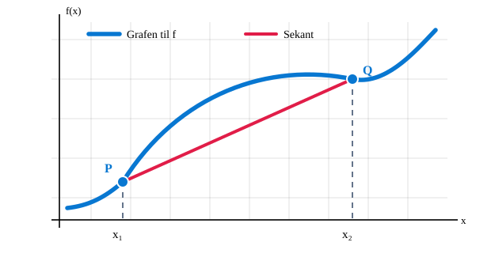

# 3.1 Vekstfart og tangent

## Læringsmål

Når du har arbeidet med dette delkapitlet, skal du kunne:

- skille mellom **gjennomsnittlig** og **momentan vekstfart**
- beregne gjennomsnittlig vekstfart mellom to x-verdier
- forklare at momentan vekstfart er stigningstallet til tangenten i punktet
- finne tangentens funksjonsuttrykk ved å bruke formen \(y=ax+b\)

!!! important "Kort repetisjon – dette må du kunne"
    - **Gjennomsnittlig vekstfart:** stigningstallet til sekanten mellom to punkter.
    - **Momentan vekstfart:** stigningstallet til tangenten i ett punkt.
    - **Tangentlikning:** bruk punktet \(P=(x_1,y_1)\) og stigningstallet \(a=f'(x_1)\) i \(y-y_1=a(x-x_1)\).

    Hvis du kan forklare disse tre punktene og bruke formlene, gå direkte til oppgavene for å kontrollere at du husker metoden.

## Hvorfor bryr vi oss om den deriverte?

Den deriverte hjelper oss å beskrive **hvor raskt noe endrer seg akkurat nå**. Det er nyttig i mange situasjoner:

- **Fart:** Hvor fort kjører bilen akkurat i dette øyeblikket?
- **Grafer:** Hvor raskt øker eller minker en funksjon på et bestemt sted?

I alle disse eksemplene handler det om endring. Den deriverte gir oss et mål på hvor rask endringen er. I dette kapittelet skal vi se at den også kan forstås geometrisk: Den deriverte i et punkt er stigningstallet til tangenten til grafen i punktet.

## 1. Gjennomsnittlig og momentan vekstfart

Tenk at du sykler en tur. Gjennomsnittsfarten beskriver hele turen, mens sykkelcomputeren kan vise farten **akkurat nå**. Dette er to forskjellige spørsmål.

| Gjennomsnittlig vekstfart | Momentan vekstfart |
|---|---|
| Endring **mellom to punkter** på grafen. | Endring **i ett bestemt punkt** på grafen. |
| Vi bruker en **sekant** gjennom to punkter. | Vi bruker en **tangent** i ett punkt. |
| Som gjennomsnittsfarten på en hel tur. | Som farten sykkelcomputeren viser akkurat nå. |

Begge beskriver hvor raskt noe endrer seg. Forskjellen er om vi ser på et helt intervall eller ett bestemt øyeblikk.

## 2. Hva betyr den deriverte i et punkt?

Den deriverte til en funksjon \(f\) i punktet \(x=a\) skrives

\[
f'(a)
\]

Verdien \(f'(a)\) forteller hvor raskt funksjonen endrer seg akkurat når \(x=a\). Det er den **momentane vekstfarten**.

Geometrisk forteller den samme verdien oss **stigningstallet til tangenten** til grafen i punktet \(P=(x_1,y_1)\).

### Figur 1 – Graf, punkt og tangent

Se på funksjonen \(f(x)=x^2\) og punktet \(P=(1,1)\).

<figure markdown>
<svg viewBox="0 0 360 270" role="img" aria-label="Grafen y lik x i andre og tangenten y lik 2x minus 1 i punktet 1,1" xmlns="http://www.w3.org/2000/svg">
  <defs>
    <clipPath id="plot1"><rect x="42" y="18" width="286" height="218"/></clipPath>
  </defs>
  <g stroke="currentColor" stroke-opacity="0.13" stroke-width="1">
    <path d="M60 20V236 M100 20V236 M140 20V236 M180 20V236 M220 20V236 M260 20V236 M300 20V236"/>
    <path d="M42 36H328 M42 76H328 M42 116H328 M42 156H328 M42 196H328 M42 236H328"/>
  </g>
  <g stroke="currentColor" stroke-width="1.4" fill="none">
    <path d="M42 196H333"/>
    <path d="M60 242V14"/>
  </g>
  <g fill="currentColor" font-size="10">
    <text x="334" y="191">x</text><text x="67" y="15">y</text>
    <text x="48" y="209">0</text><text x="96" y="209">1</text><text x="136" y="209">2</text><text x="176" y="209">3</text>
    <text x="44" y="160">1</text><text x="44" y="120">2</text><text x="44" y="80">3</text><text x="44" y="40">4</text>
  </g>
  <g clip-path="url(#plot1)">
    <path d="M60 196 C73.3 196 86.7 182.7 100 156 C113.3 129.3 126.7 89.3 140 36" fill="none" stroke="#16803d" stroke-width="3"/>
    <path d="M60 236 L140 76" fill="none" stroke="#d97706" stroke-width="2.5"/>
    <path d="M100 156 L140 156 L140 76" fill="none" stroke="#d97706" stroke-width="1.5" stroke-dasharray="4 3"/>
  </g>
  <circle cx="100" cy="156" r="5" fill="#16803d" stroke="white" stroke-width="1.3"/>
  <g fill="currentColor" font-size="10">
    <text x="105" y="148">P = (1, 1)</text>
    <text x="104" y="171" fill="#d97706">1 rute bort</text>
    <text x="145" y="119" fill="#d97706">2 ruter opp</text>
    <text x="203" y="52" fill="#16803d">f(x) = x²</text>
  </g>
</svg>
<figcaption>Fra P går vi 1 rute mot høyre og 2 ruter opp langs tangenten. Stigningstallet er derfor 2/1 = 2. Tangenten berører grafen i P.</figcaption>
</figure>

For denne funksjonen er den deriverte i \(x=1\) lik \(f'(1)=2\). Det betyr at tangenten i punktet \(P=(x_1,y_1)=(1,1)\) har stigningstall 2.

**Husk:** \(f'(1)\) er et tall – stigningstallet akkurat i punktet \(x=1\). \(f'(x)\) betegner derimot den deriverte som en funksjon av \(x\).

## 3. Gjennomsnittlig vekstfart

Den **gjennomsnittlige vekstfarten** forteller hvor mye funksjonsverdien endrer seg i gjennomsnitt når vi går fra én x-verdi til en annen. Geometrisk er den stigningstallet til en **sekant** – en rett linje som går gjennom to punkter på grafen.

!!! important "Formel for gjennomsnittlig vekstfart"
    \[
    a=\frac{f(x_2)-f(x_1)}{x_2-x_1}
    \]

Her er \(x_1\) og \(x_2\) start- og sluttverdiene på x-aksen. Telleren viser endringen i funksjonsverdi, og nevneren viser endringen i x.

### Sekant: gjennomsnittlig vekstfart

Den blå kurven viser grafen til \(f\), mens den røde, rette linjen er sekanten gjennom P og Q. **Sekantens stigningstall** er den gjennomsnittlige vekstfarten mellom \(x_1\) og \(x_2\).

!!! example "Eksempel – Finn gjennomsnittlig vekstfart"

    La \(f(x)=x^2\). Vi finner gjennomsnittlig vekstfart fra \(x=1\) til \(x=4\).

    **Steg 1: Finn funksjonsverdiene.**

    \[
    f(1)=1^2=1,\qquad f(4)=4^2=16
    \]

    **Steg 2: Bruk formelen for gjennomsnittlig vekstfart.**

    \[
    a=\frac{f(4)-f(1)}{4-1}
    =\frac{16-1}{3}=5
    \]

    **Svar:**

    \[
    \underline{\underline{a=5}}
    \]

    Den gjennomsnittlige vekstfarten fra \(x=1\) til \(x=4\) er 5.

## 4. Momentan vekstfart

Tenk deg at \(s(t)\) beskriver hvor langt en syklist har beveget seg etter \(t\) sekunder.

- Gjennomsnittlig vekstfart beskriver endringen over et tidsintervall.
- Momentan vekstfart beskriver farten ved ett bestemt tidspunkt.
- Når grafen viser strekning som funksjon av tid, er den momentane vekstfarten stigningstallet til tangenten.

### Figur – Tangenten viser vekstfarten akkurat i punktet

<figure markdown>
<svg viewBox="0 0 360 255" role="img" aria-label="Strekning som funksjon av tid med tangent i et bestemt tidspunkt" xmlns="http://www.w3.org/2000/svg">
  <defs><clipPath id="plot2"><rect x="46" y="18" width="282" height="200"/></clipPath></defs>
  <g stroke="currentColor" stroke-opacity="0.13" stroke-width="1">
    <path d="M60 20V218 M110 20V218 M160 20V218 M210 20V218 M260 20V218 M310 20V218"/>
    <path d="M46 218H328 M46 178H328 M46 138H328 M46 98H328 M46 58H328 M46 18H328"/>
  </g>
  <g stroke="currentColor" stroke-width="1.4" fill="none">
    <path d="M46 218H334"/><path d="M60 228V12"/>
  </g>
  <g fill="currentColor" font-size="10">
    <text x="336" y="213">t (s)</text><text x="68" y="13">s(t) (m)</text>
    <text x="48" y="231">0</text><text x="106" y="231">1</text><text x="156" y="231">2</text><text x="206" y="231">3</text><text x="256" y="231">4</text>
  </g>
  <g clip-path="url(#plot2)">
    <path d="M60 218 Q160 218 260 18" fill="none" stroke="#16803d" stroke-width="3"/>
    <path d="M110 218 L260 68" fill="none" stroke="#d97706" stroke-width="2.5"/>
  </g>
  <circle cx="160" cy="168" r="5" fill="#16803d" stroke="white" stroke-width="1.3"/>
  <g fill="currentColor" font-size="11">
    <text x="169" y="159">Tidspunktet t = a</text>
    <text x="248" y="62" fill="#d97706">Tangent</text>
  </g>
</svg>
<figcaption>På en strekning–tid-graf er tangentens stigningstall den momentane farten på det aktuelle tidspunktet.</figcaption>
</figure>

- Hvis tangenten stiger mot høyre, er vekstfarten positiv.
- Hvis tangenten er vannrett, er vekstfarten null.
- Hvis tangenten synker mot høyre, er vekstfarten negativ.

I en strekning–tid-modell måles den momentane vekstfarten i for eksempel meter per sekund (m/s).

## 5. Tangentens likning – finn funksjonsuttrykket

Den enkleste metoden er ofte å starte med \(y=ax+b\). Når vi kjenner tangentens stigningstall, bruker vi punktet på grafen til å finne konstanten \(b\). Vi kan også bruke et punkts formel:

!!! important "Ettpunktsformelen"
    \[
    y-y_1=a(x-x_1)
    \]

Dette kalles **ettpunktsformelen**.

For tangenten til grafen til \(f\) i \(x=x_1\) kjenner vi både punktet og stigningstallet:

- Punktet er \(P=(x_1,y_1)\), der \(y_1=f(x_1)\).
- Stigningstallet er \(a=f'(x_1)\).

Tangentens likning blir derfor:

!!! important "Tangentens likning"
    \[
    y-y_1=a(x-x_1)
    \]

!!! example "Eksempel – Finn tangentens likning steg for steg"

    Vi bruker \(f(x)=x^2\) og finner tangenten der \(x=1\). Punktet på grafen er \(P=(x_1,y_1)=(1,1)\), og tangentens stigningstall er \(f'(1)=2\).

    **Steg 1: Start med likningen for en rett linje.**

    \[
    y=ax+b
    \]

    **Steg 2: Sett inn stigningstallet.**

    Siden stigningstallet er \(a=2\), får vi

    \[
    y=2x+b
    \]

    **Steg 3: Bruk punktet til å finne \(b\).**

    Punktet \(P=(x_1,y_1)=(1,1)\) ligger på tangenten. Sett derfor inn \(x=1\) og \(y=1\):

    \[
    1=2\cdot1+b
    \]

    \[
    1=2+b\qquad\Rightarrow\qquad b=-1
    \]

    **Svar:**

    \[
    \underline{\underline{y=2x-1}}
    \]

    **Husk metoden:** Finn punktet, finn tangentens stigningstall, sett inn i \(y=ax+b\), og bruk punktet til å finne \(b\).

## 6. Oppgaver

Prøv å løse oppgavene før du åpner fasiten. Vis mellomregning der du regner.

## 🟢 Grønn – Grunnlag

!!! question "Oppgave 1 – Gjennomsnittlig vekstfart"

    Gitt funksjonen \(f(x)=x^2\).

    a) Finn gjennomsnittlig vekstfart fra \(x=1\) til \(x=3\).

    b) Finn gjennomsnittlig vekstfart fra \(x=2\) til \(x=4\).

    c) Forklar hvorfor svarene er forskjellige.

!!! question "Oppgave 2 – Gjennomsnittlig vekstfart i praksis"

    En plante er 12 cm høy etter én uke og 27 cm høy etter fire uker.

    a) Finn plantens gjennomsnittlige vekstfart i cm per uke mellom uke 1 og uke 4.

    b) Forklar hva svaret betyr.

    c) Betyr svaret at planten vokste nøyaktig like mange centimeter hver uke?

!!! question "Oppgave 3 – Gjennomsnittlig vekstfart med en lineær funksjon"

    Gitt funksjonen \(f(x)=3x+2\).

    a) Finn gjennomsnittlig vekstfart fra \(x=1\) til \(x=5\).

    b) Finn gjennomsnittlig vekstfart fra \(x=2\) til \(x=6\).

    c) Hva legger du merke til ved svarene? Forklar hvorfor.

## 🟡 Gul – Kombiner ideer

!!! question "Oppgave 4 – Sammenlign gjennomsnittlig vekstfart"

    Gitt funksjonen \(f(x)=x^2+1\).

    a) Finn gjennomsnittlig vekstfart fra \(x=0\) til \(x=2\).

    b) Finn gjennomsnittlig vekstfart fra \(x=2\) til \(x=4\).

    c) I hvilket intervall vokser funksjonen raskest i gjennomsnitt?

!!! question "Oppgave 5 – Forstå den deriverte"

    En funksjon har \(f'(2)=5\).

    a) Hva er stigningstallet til tangenten når \(x=2\)?

    b) Hva forteller tallet 5 om den momentane vekstfarten?

    c) Hvis tangenten i et annet punkt har stigningstall 0, hva forteller det om den momentane vekstfarten der?

    d) Tegn en mulig skisse

!!! question "Oppgave 6 – Fra stigningstall til tangent"

    En tangent går gjennom punktet \(P=(2,5)\) og har stigningstall 3. Finn funksjonsuttrykket for tangenten.

!!! question "Oppgave 7 – Tangent til en parabel"

    Grafen til \(f(x)=x^2\) har punktet \(P=(x_1,y_1)=(2,4)\). Den deriverte i dette punktet er \(f'(2)=4\).

    Hva er tangentens stigningstall?

    Bruk et punkts formel til å finne tangentens likning, og skriv svaret på formen \(y=ax+b\).

!!! question "Oppgave 8 – Finn tangentens funksjonsuttrykk"

    En tangent går gjennom punktet \(P=(3,7)\) og har stigningstall \(-2\). Finn tangentens funksjonsuttrykk på formen \(y=ax+b\).

!!! question "Oppgave 9 – Tangent til en annen funksjon"

    Grafen til en funksjon går gjennom punktet \(P=(1,3)\), og tangenten i dette punktet har stigningstall \(4\). Finn tangentens funksjonsuttrykk på formen \(y=ax+b\).

!!! question "Oppgave 10 – Finn tangenten når funksjonen er gitt"

    Gitt funksjonen \(f(x)=x^2+1\).

    Finn tangentens funksjonsuttrykk når \(x=2\). Skriv svaret på formen \(y=ax+b\).

!!! question "Oppgave 11 – Tangent til en andregradsfunksjon"

    Gitt funksjonen \(f(x)=2x^2-3x+1\).

    Finn tangentens funksjonsuttrykk når \(x=1\). Skriv svaret på formen \(y=ax+b\).

!!! question "Oppgave 12 – Tangent med negativt stigningstall"

    Gitt funksjonen \(f(x)=x^2-4x+2\).

    Finn tangentens funksjonsuttrykk når \(x=1\). Skriv svaret på formen \(y=ax+b\).

## 🔴 Rød – Selvstendig problemløsing

!!! question "Oppgave 13 – Momentan fart"

    Posisjonen til en syklist beskrives av \(s(t)\), der \(t\) måles i sekunder og \(s(t)\) i meter. Ved \(t=3\) er \(s(3)=20\) og \(s'(3)=6\).

    a) Hva er syklistens momentane vekstfart ved \(t=3\)?

    b) Hva er stigningstallet til tangenten på strekning–tid-grafen ved \(t=3\)?

    c) Finn tangentens likning. Bruk \(t\) på den vannrette aksen og \(s\) på den loddrette aksen.

!!! question "Oppgave 14 – Tegn og tolk"

    Tegn en skisse av en funksjonsgraf med et punkt \(P\) der tangenten har positivt stigningstall.

    a) Tegn tangenten i punktet.

    b) Forklar hva stigningstallet forteller om den momentane vekstfarten.

    c) Lag en ny skisse der tangenten har negativt stigningstall. Hva er forskjellen?

!!! question "Oppgave 15 – Finn to ulike tangenter"

    En rett linje går gjennom punktet \(P=(x_1,y_1)=(3,4)\).

    a) Finn likningen til linjen når stigningstallet er \(a=2\).

    b) Finn likningen til en annen linje gjennom samme punkt når stigningstallet er \(a=-1\).

    c) Tegn begge linjene i samme koordinatsystem. Hva er likt, og hva er forskjellig?

??? note "Fasit – åpne når du har prøvd selv"

    **Oppgave 1**

    a) \(a=\frac{f(3)-f(1)}{3-1}=\frac{9-1}{2}=4\).

    b) \(a=\frac{f(4)-f(2)}{4-2}=\frac{16-4}{2}=6\).

    c) Gjennomsnittlig vekstfart er større i intervallet fra 2 til 4.

    **Oppgave 2**

    a) \(a=\frac{27-12}{4-1}=5\) cm per uke.

    b) Planten vokste i gjennomsnitt 5 cm per uke i perioden.

    c) Nei. Gjennomsnittet beskriver hele perioden, ikke veksten i hver enkelt uke.

    **Oppgave 3**

    a) \(a=\frac{f(5)-f(1)}{5-1}=\frac{17-5}{4}=3\).

    b) \(a=\frac{f(6)-f(2)}{6-2}=\frac{20-8}{4}=3\).

    c) Svarene er like fordi en lineær funksjon har konstant stigningstall.

    **Oppgave 4**

    a) \(a=\frac{f(2)-f(0)}{2-0}=\frac{5-1}{2}=2\).

    b) \(a=\frac{f(4)-f(2)}{4-2}=\frac{17-5}{2}=6\).

    c) Funksjonen vokser raskest i gjennomsnitt fra \(x=2\) til \(x=4\).

    **Oppgave 5**

    a) Stigningstallet er 5.

    b) Funksjonen øker momentant med 5 enheter i \(y\) for hver enhet i \(x\), ved \(x=2\). I en fysisk modell avhenger enhetene av hva \(x\) og \(y\) beskriver.

    c) Den momentane vekstfarten er 0; tangenten er vannrett.

    d) Skissen kan variere. Tangenten skal stige mot høyre og ha stigningstall 5, for eksempel 5 ruter opp for hver rute mot høyre. Punktets høyde kan velges fritt.

    **Oppgave 6**

    \[
    y-5=3(x-2)
    \]

    \[
    y-5=3x-6
    \]

    \[
    \boxed{y=3x-1}
    \]

    **Oppgave 7**

    Stigningstallet er \(f'(2)=4\).

    \[
    y-4=4(x-2)\quad\Rightarrow\quad \boxed{y=4x-4}
    \]

    **Oppgave 8**

    \[
    y-7=-2(x-3)\quad\Rightarrow\quad \boxed{y=-2x+13}
    \]

    **Oppgave 9**

    \[
    y-3=4(x-1)\quad\Rightarrow\quad \boxed{y=4x-1}
    \]

    **Oppgave 10**

    \[
    f(2)=2^2+1=5,\qquad f'(x)=2x,\qquad f'(2)=4
    \]

    Tangenten går gjennom \((2,5)\) og har stigningstall 4:

    \[
    y-5=4(x-2)\quad\Rightarrow\quad \boxed{y=4x-3}
    \]

    **Oppgave 11**

    \[
    f(1)=2-3+1=0,\qquad f'(x)=4x-3,\qquad f'(1)=1
    \]

    Tangenten går gjennom \((1,0)\) og har stigningstall 1:

    \[
    y-0=1(x-1)\quad\Rightarrow\quad \boxed{y=x-1}
    \]

    **Oppgave 12**

    \[
    f(1)=1-4+2=-1,\qquad f'(x)=2x-4,\qquad f'(1)=-2
    \]

    Tangenten går gjennom \((1,-1)\) og har stigningstall \(-2\):

    \[
    y+1=-2(x-1)\quad\Rightarrow\quad \boxed{y=-2x+1}
    \]

    **Oppgave 13**

    a) Den momentane vekstfarten er \(6\text{ m/s}\).

    b) Tangentens stigningstall er 6.

    c)

    \[
    s-20=6(t-3)
    \]

    \[
    \boxed{s=6t+2}
    \]

    **Oppgave 14**

    a–c) Tegningene kan variere. Positivt stigningstall betyr at tangenten stiger mot høyre; negativt stigningstall betyr at den synker mot høyre.

    **Oppgave 15**

    a)

    \[
    y-4=2(x-3)\quad\Rightarrow\quad \boxed{y=2x-2}
    \]

    b)

    \[
    y-4=-(x-3)\quad\Rightarrow\quad \boxed{y=-x+7}
    \]

    c) Begge linjene går gjennom \((3,4)\), men de har ulike stigningstall.

## 7. Programmering – løs vekstfart og tangent med Python

I disse oppgavene bruker du Python til å regne ut størrelser vi har arbeidet med i kapittelet. Målet er ikke bare å få et svar, men også å forstå hvilken matematisk metode programmet bruker.

### 🟢 Grønn – Beregn gjennomsnittlig vekstfart

!!! question "Programmeringsoppgave 1 – Gjennomsnittlig vekstfart"
    Vi bruker funksjonen \(f(x)=x^2\) og formelen for gjennomsnittlig vekstfart:

    \[
    a=\frac{f(x_2)-f(x_1)}{x_2-x_1}
    \]

    **a)** Lag en funksjon med `def` som beregner \(f(x)=x^2\). Funksjonen skal ta inn en x-verdi og returnere funksjonsverdien.

    **b)** Bruk funksjonen din til å beregne \(f(x_1)\) og \(f(x_2)\) når \(x_1=1\) og \(x_2=3\).

    **c)** Bruk funksjonsverdiene til å beregne den gjennomsnittlige vekstfarten fra \(x=1\) til \(x=3\).

    **d)** Gjenta beregningen fra \(x=2\) til \(x=4\). Sammenlign svarene og forklar hvorfor vekstfarten er forskjellig.

!!! question "Programmeringsoppgave 2 – Vekst i praksis"
    En plante er 12 cm høy etter én uke og 27 cm høy etter fire uker.

    **a)** Bruk funksjonen fra oppgave 1 til å beregne gjennomsnittlig vekstfart.

    **b)** Skriv ut svaret sammen med teksten `cm per uke`.

    **c)** Endre programmet slik at du også kan bruke det på andre start- og sluttverdier.

### 🟡 Gul – Bruk funksjoner og lag tangentlikninger

!!! question "Programmeringsoppgave 3 – Finn tangentens likning"
    En tangent går gjennom punktet \((x_1,y_1)=(2,5)\) og har stigningstall \(a=3\).

    Bruk ettpunktsformelen

    \[
    y-y_1=a(x-x_1)
    \]

    **a)** Lag en funksjon `finn_konstant(x1, y1, a)` som returnerer konstanten \(b\) i likningen \(y=ax+b\).

    **b)** Bruk funksjonen til å finne \(b\) for punktet og stigningstallet ovenfor.

    **c)** Skriv ut hele tangentens likning, for eksempel på formen `y = 3x - 1`.

    **Hint:** Sett punktet inn i \(y=ax+b\) og løs likningen \(b=y_1-ax_1\).

!!! question "Programmeringsoppgave 4 – Sammenlign tangenter"
    Lag et program som finner tangentlikningen for linjer gjennom samme punkt \((3,4)\).

    **a)** Bruk funksjonen fra oppgave 3 med stigningstall \(2\).

    **b)** Gjenta med stigningstall \(-1\).

    **c)** Skriv ut begge likningene. Forklar hvorfor de har samme punkt, men ulike stigningstall.

### 🔴 Rød – Sett sammen flere steg

!!! question "Programmeringsoppgave 5 – Fra funksjonsverdier til tangent"
    Vi arbeider med funksjonen \(f(x)=x^2+1\). Når \(x=2\), er \(f(2)=5\), og den deriverte er \(f'(2)=4\).

    **a)** Lag variabler for punktets x-verdi, funksjonsverdi og tangentens stigningstall.

    **b)** Bruk funksjonen fra oppgave 3 til å finne konstanten \(b\).

    **c)** Skriv ut tangentens likning på formen \(y=ax+b\).

    **d)** Sammenlign resultatet med tangentlikningen du fant ved regning i oppgave 10 tidligere i kapittelet.

!!! question "Programmeringsoppgave 6 – Lag en liten kalkulator"
    Lag et program som ber brukeren skrive inn:
    
    - to x-verdier \(x_1\) og \(x_2\)
    - funksjonsverdiene \(f(x_1)\) og \(f(x_2)\)

    Programmet skal beregne og skrive ut gjennomsnittlig vekstfart.

    **a)** Bruk `input()` til å lese inn verdiene og gjør dem om til tall med `float()`.

    **b)** Bruk funksjonen fra oppgave 1.

    **c)** Test programmet med \(f(x)=x^2\), først fra \(x=1\) til \(x=3\), og deretter fra \(x=2\) til \(x=4\).

    **d)** Hva bør programmet gjøre dersom brukeren skriver inn samme x-verdi for \(x_1\) og \(x_2\)? Endre programmet slik at det gir en forståelig melding i stedet for å dele på null.
